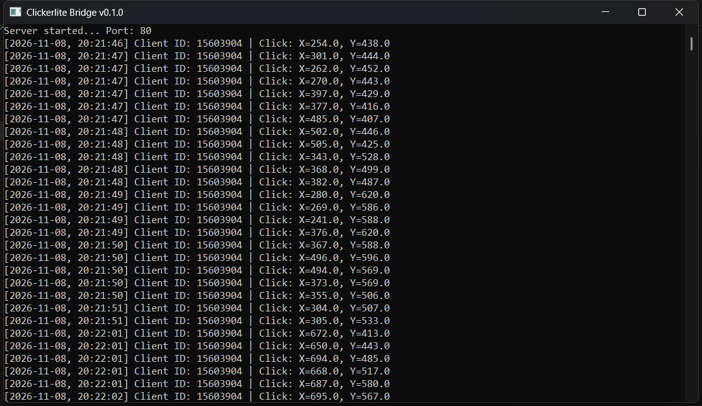
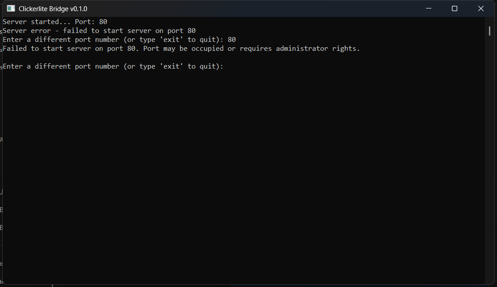
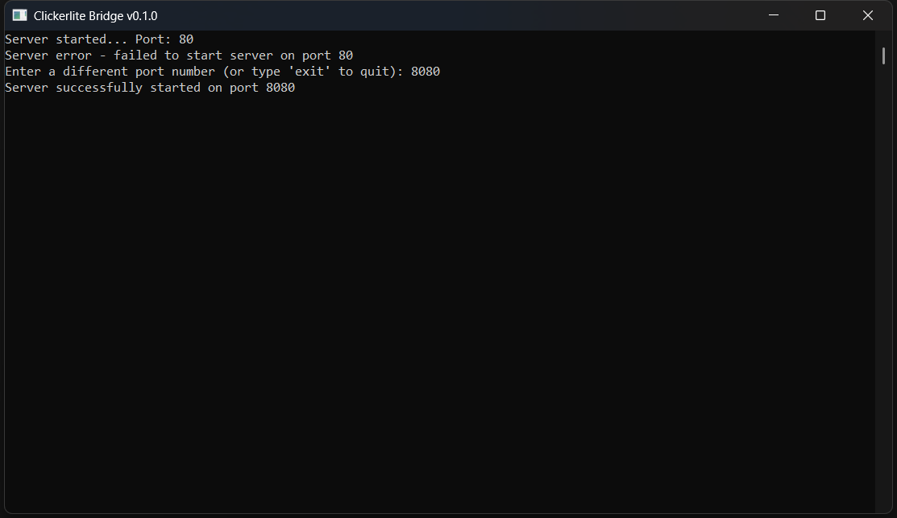

# Clickerlite Bridge 🌉

[](https://opensource.org/licenses/Apache-2.0)
[](releases)
[](https://www.purebasic.com/)
[](#-architecture--how-it-works)

**Clickerlite Bridge** is a lightweight local HTTP server written in PureBasic that accepts JSON coordinates via HTTP and executes physical mouse clicks at the operating system level (WinAPI) in Windows.

This project demonstrates the concept of Inter-Process Communication (IPC), bridging web technologies (HTML, JavaScript, browser extensions) with native system programming.



## Architecture & How It Works 🎯

```text
[ Any Source: HTML Page / Extension / Script ]
                        │
                        ▼  HTTP POST (JSON: {x, y}) to 127.0.0.1:80
               [ Clickerlite Bridge ]
                        │
                        ▼  WinAPI (SetCursorPos_, mouse_event_)
             [ System Mouse Click in Windows ]
```
Sender (browser extension, local HTML page, or local script) calculates the element's coordinates and sends an AJAX/HTTP request to 127.0.0.1.

**Clickerlite Bridge** receives the request, parses the JSON payload, and instantly executes the mouse click event via WinAPI.

> [!NOTE]
> If the default port is already occupied by another application or requires administrator privileges, the console will prompt you to enter an alternative port number.

 

## Key Advantage: `isTrusted = true` 🔒
When emulating clicks using standard JavaScript (`element.click()`), the browser sets the event flag `event.isTrusted = false`. Website defense mechanisms and anti-fraud systems easily detect such actions and block automation.

Since **Clickerlite Bridge** sends commands directly to the operating system:
* The click event is generated at the hardware/system level.
* The browser perceives the click as a real user action and sets `event.isTrusted = true`.
* Emulation does not require launching the browser in debugging mode (`DevTools Protocol`) or using frameworks like Selenium/Puppeteer, which trigger automation flags (`navigator.webdriver`).

> [!NOTE]
> For a successful click, the target element must be located within the visible viewport of the browser.

## Use Cases 🛠️
* **Local RPA & Workflow Automation**: Building lightweight automation scripts in standard user browsers without heavy frameworks.
* **Anti-Fraud System Testing**: Analyzing the resilience of security algorithms against low-level user input emulation.
* **UI/UX & E2E Testing**: End-to-end testing of web pages combined with desktop environments.
* **Web & Desktop Integration**: Managing desktop OS features from local web interfaces (HTML/JS).

## Technical Specifications ⚙️
**Language**: PureBasic (v5.70 LTS / Windows - x86)
**Transport**: Local HTTP Server (127.0.0.1:80, TCP)
**Data Format**: application/json json ({"x": 100, "y": 200})
**Dependencies**: None (single standalone `.exe` file)

## Download & Releases 📦
You can download the latest compiled executable from the [Releases](../../releases) page.
Compatibility: Windows (x86 / x64)

## 🌐 Demo Page
The repository includes a simple web page located in the `demo page/` directory, designed for testing the clicker bridge in action.

**How it works:**
1. Open the `index.html` file from the `demo page` folder in any web browser.
2. The page displays an interactive control panel with buttons and keyboard shortcuts.
3. When **Clickerlite Bridge** is running locally, a browser extension or a script from this page can send click coordinates based on your input, demonstrating instant and precise system-level response.

## Related Projects 🔗
[**Clickerlite**](https://github.com/vladnzv/clickerlite) — The original lightweight desktop auto-clicker with a graphical interface and global hotkeys (shares the common clicker engine).

## Disclaimer ⚠️
**Clickerlite Bridge** is created for educational purposes, as well as for researching automation methods and interface testing. The author is not responsible for any use of this software that violates the terms of service or license agreements of third-party platforms.